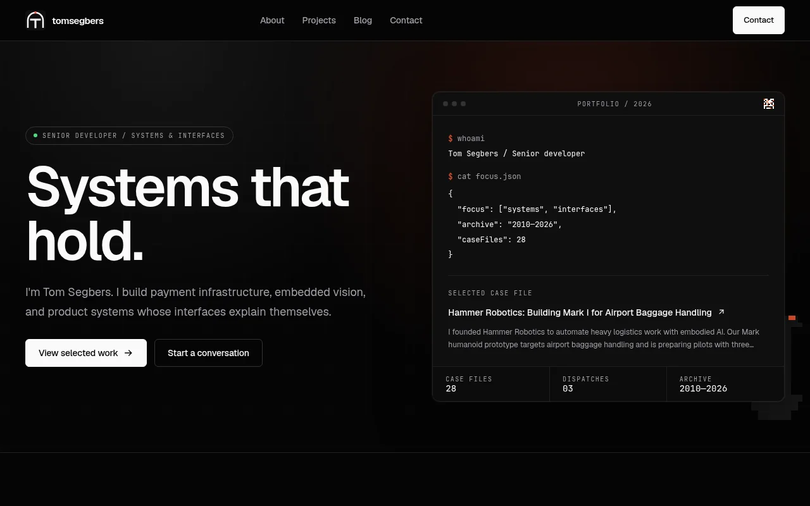
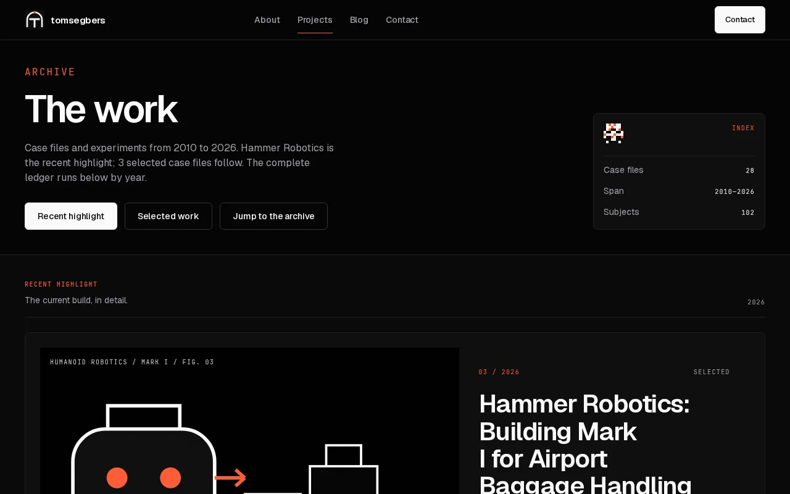
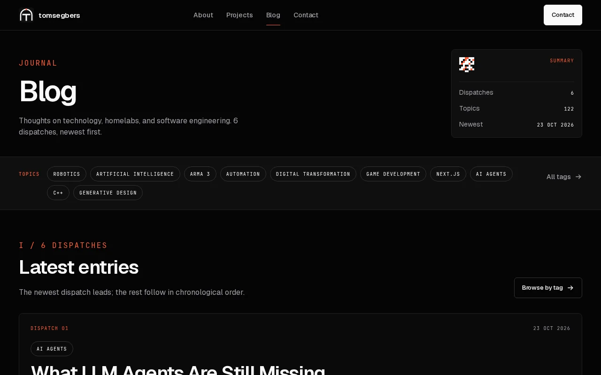
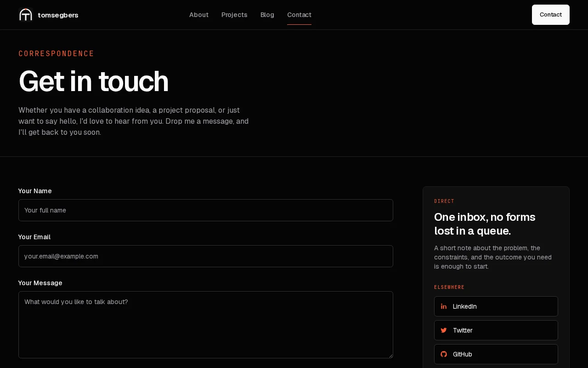

# TomSegbers.de — Personal Portfolio of Tom Segbers, Senior Developer

[](http://192.168.7.69:3002/TomSegbers/tomsegbers-de/actions)

Source for [tom.segbers.de](https://tom.segbers.de), a personal portfolio site.
Static, no auth, no database, no tracking. Content lives as Markdown files under
`content/`. The site is built with the Next.js App Router and pre-rendered with
static site generation (SSG) on the Node/Vercel runtime.

> **Repository host**: this repository was migrated from GitHub to the local
> Forgejo instance ([TomSegbers/tomsegbers-de](http://192.168.7.69:3002/TomSegbers/tomsegbers-de))
> on 2026-08-09. CI runs on Forgejo Actions (`.forgejo/workflows/`).

## Table of Contents

- [Showcase](#showcase)
- [Tech Stack](#tech-stack)
- [Getting Started](#getting-started)
- [Available Scripts](#available-scripts)
- [Project Structure](#project-structure)
- [Content](#content)
- [Testing](#testing)
- [Deployment](#deployment)
- [Conventions](#conventions)
- [Environment Variables](#environment-variables)
- [License](#license)

## Showcase

|                                     Home                                      |                                         Projects                                          |
| :---------------------------------------------------------------------------: | :---------------------------------------------------------------------------------------: |
| [](public/img/screenshots/home.webp) | [](public/img/screenshots/projects.webp) |
|     Landing page with hero introduction, featured work, and latest posts.     |         Full portfolio gallery with technology tags and detailed project entries.         |
|                                   **Blog**                                    |                                        **Contact**                                        |
| [](public/img/screenshots/blog.webp) |  [](public/img/screenshots/contact.webp)   |
| Article index sorted by date with markdown rendering and typography styling.  |          Interactive contact form powered by a Next.js server action and Resend.          |

## Tech Stack

- **[Next.js 15.5.24](https://nextjs.org/)** with the App Router, pre-rendered
  via static site generation (SSG) on the Node/Vercel runtime. `output: 'export'`
  is deliberately not used — the contact form server action needs a Node runtime.
- **[TypeScript](https://www.typescriptlang.org/)** in `strict` mode,
  `noUncheckedIndexedAccess` on, `unknown` over `any`, Zod at boundaries
- **[Tailwind CSS](https://tailwindcss.com/)** with
  [`@tailwindcss/typography`](https://tailwindcss.com/docs/typography-plugin)
  for Markdown body text
- **[Flowbite React](https://flowbite-react.com/)** for the `Card` primitive
  only; the header, breadcrumb, and alert are in-tree components
- **[Nix flake](https://nixos.org/)** + **[direnv](https://direnv.net/)** for a
  reproducible dev shell (Node 22, pnpm, git, Playwright Chromium libs)
- **[pnpm](https://pnpm.io/)** as the package manager
  (`packageManager: pnpm@10.15.1`)
- **[Jest](https://jestjs.io/)** with
  [React Testing Library](https://testing-library.com/react) for unit and
  component tests
- **[Playwright](https://playwright.dev/)** for end-to-end tests
- **[Storybook](https://storybook.js.org/)** for component visual smoke tests
- **[Resend](https://resend.com/)** for the contact form server action
- **[gray-matter](https://github.com/jonschlinkert/gray-matter)** for Markdown
  frontmatter parsing
- **[await-to-js](https://github.com/scopsy/await-to-js)** for explicit async
  error tuples
- **[T3 Env](https://env.t3.gg/)** for type-safe environment variables

## Getting Started

```bash
git clone ssh://git@forgejo:2222/TomSegbers/tomsegbers-de.git TomSegbers.de
cd TomSegbers.de
direnv allow          # activates the Nix devShell with Node 22 + pnpm
pnpm install --frozen-lockfile
pnpm dev              # http://localhost:3000
```

`direnv allow` loads the Nix flake declared in `flake.nix` and `.envrc`, which
provides `nodejs_22`, `pnpm`, `git`, and the shared libraries Playwright
Chromium needs. If you skip Nix, install Node.js >= 18.17 and pnpm yourself.

Note on the Nix devShell: it exports `PNPM_HOME` and `npm_config_prefix` as
`null`, which crashes pnpm 11. When running pnpm inside the devShell, unset
them first:

```bash
unset PNPM_HOME npm_config_prefix
```

A pre-commit hook enforces
[Conventional Commits](https://www.conventionalcommits.org/) via
`.pre-commit-config.yaml`. It is installed automatically by `pre-commit install
-t commit-msg` once `pre-commit` is available in your shell.

## Available Scripts

From `package.json`:

| Script                 | Purpose                                                 |
| ---------------------- | ------------------------------------------------------- |
| `pnpm dev`             | Start the dev server with colorized output              |
| `pnpm build`           | Production build, generates static pages                |
| `pnpm start`           | Run the production build locally                        |
| `pnpm lint`            | Run ESLint over `*.ts` and `*.tsx`                      |
| `pnpm lint:fix`        | Auto-fix lint errors                                    |
| `pnpm typecheck`       | Type-check with `tsc --noEmit`                          |
| `pnpm prettier`        | Check formatting                                        |
| `pnpm prettier:fix`    | Apply Prettier fixes                                    |
| `pnpm test`            | Run Jest unit and component tests                       |
| `pnpm e2e:headless`    | Run Playwright e2e tests in headless mode               |
| `pnpm e2e:ui`          | Run Playwright e2e tests with the interactive UI        |
| `pnpm storybook`       | Start Storybook on port 6006                            |
| `pnpm build-storybook` | Build a static Storybook bundle                         |
| `pnpm test-storybook`  | Run Storybook smoke tests against the built bundle      |
| `pnpm analyze`         | Build with `@next/bundle-analyzer` enabled              |
| `pnpm lighthouse`      | Run Lighthouse CI budgets (LCP/CLS/TBT)                 |
| `pnpm budget:bundle`   | Check bundle bytes against the committed baseline       |
| `pnpm contrast`        | Check token pairs against WCAG contrast ratios          |
| `pnpm ornaments`       | Gate banned ornaments and off-token decorations         |
| `pnpm images`          | Enforce image byte budget (`≤200 KB`, hero `≤50 KB`)    |
| `pnpm fonts`           | Enforce font budget (`≤2 families`, `≤100 KiB`)         |
| `pnpm coupling-graph`  | Render module dependency graph to `graph.svg` via Madge |
| `pnpm format`          | Apply Prettier to `*.ts`, `*.tsx`, `*.md`               |

For e2e tests, Playwright needs a Chromium browser. Inside the Nix devShell,
set `PLAYWRIGHT_BROWSERS_PATH` to the local cache so Playwright finds a
matching build:

```bash
export PLAYWRIGHT_BROWSERS_PATH=$HOME/.cache/ms-playwright
```

## Project Structure

```
.
├── AGENTS.md                  # Agent-facing project rules and conventions
├── README.md
├── LICENSE
├── flake.nix                  # Nix devShell: Node 22, pnpm, git, Chromium libs
├── flake.lock
├── .forgejo/
│   └── workflows/             # Forgejo Actions CI (check, e2e, bundle, lighthouse, screenshots)
├── .envrc                     # direnv entry: `use flake`
├── package.json
├── pnpm-lock.yaml
├── next.config.mjs
├── env.mjs                    # T3 Env schema (server + client vars)
├── tsconfig.json
├── jest.config.js
├── jest.setup.js
├── playwright.config.ts
├── tailwind.config.js         # Tailwind config; registers Flowbite + typography plugins
├── postcss.config.js
├── prettier.config.js
├── .eslintrc.js
├── git-conventional-commits.yaml
├── .pre-commit-config.yaml
├── app/
│   ├── layout.tsx             # Root layout: Header, Footer, metadata, viewport
│   ├── page.tsx               # Home: hero, featured work, founder arc, blog teasers
│   ├── not-found.tsx
│   ├── robots.ts              # Metadata route: allow all, points to sitemap
│   ├── sitemap.ts             # Metadata route: static + blog/project URLs
│   ├── icon.png / apple-icon.png / favicon.ico  # Next file-convention icons
│   ├── about/page.tsx
│   ├── api/health/route.ts    # Health-check endpoint (returns {status:"ok"})
│   ├── contact/page.tsx       # Contact form ("use client")
│   ├── blog/page.tsx          # Blog listing
│   ├── blog/entry/[slug]/page.tsx   # Blog detail, generateStaticParams
│   ├── projects/page.tsx      # Projects listing
│   └── projects/entry/[slug]/page.tsx  # Project detail, generateStaticParams
├── components/
│   ├── Alert/                 # In-tree status/error alert
│   ├── ArticleTeaser/         # Blog post card
│   ├── Breadcrumb/            # Detail-route breadcrumb
│   ├── Button/
│   ├── CaseStudyMeta/         # Case-study hero, role/outcome/metrics
│   ├── FeaturedSet/           # "Selected Work" featured grid
│   ├── Footer/
│   ├── FounderArc/            # "Background" founder-arc beats
│   ├── Header/                # In-tree semantic header and nav
│   ├── PersonTeaser/
│   ├── ProjectTeaser/         # Project card with technology icons
│   ├── Providers/             # Single root Tooltip provider
│   ├── TimelineEntry/
│   └── Tooltip/
├── lib/
│   ├── markdown.ts            # Shared gray-matter + Zod frontmatter reader
│   ├── blog.tsx               # getAllBlogPosts(): wraps markdown reader
│   ├── projects.tsx           # getAllProjects(): wraps markdown reader
│   ├── icon-map.ts            # Maps technology strings to icon paths
│   ├── sendEmail.tsx          # Server action, Resend contact form
│   ├── markdown.test.ts
│   ├── projects.test.ts
│   └── sendEmail.test.tsx
├── content/
│   ├── blog/*.md              # Blog posts
│   └── projects/*.md          # Project entries
├── e2e/
│   ├── *.spec.ts              # 13 Playwright e2e specs (home, blog, contact, a11y, …)
│   └── fixtures/              # axe config, route expectations, a11y allowlist
├── tests/                     # Budget fixtures (bundle baseline, contrast pairs)
├── public/
│   ├── img/                   # Photos, OG logo, and Showcase screenshots
│   └── icon/                  # SVG icons used in components
├── .storybook/
│   ├── main.ts
│   └── preview.ts
├── styles/
│   └── tailwind.css           # Tailwind entry: base/components/utilities + display & motion layers
└── scripts/
    ├── check-*.{js,mjs}       # CI gates: frontmatter, contrast, ornaments, images, fonts, bundle
    └── update-readme-screenshots.ts  # Captures Showcase screenshots from a dev server
```

## Content

All site content is Markdown with YAML frontmatter, loaded at build time by
`lib/markdown.ts`. No CMS, no database, no runtime writes. Files live in two
collections:

- `content/blog/` for blog posts, served under `/blog/entry/<slug>`
- `content/projects/` for project entries, served under `/projects/entry/<slug>`

The slug is the file name without the `.md` extension. `lib/blog.tsx` and
`lib/projects.tsx` are thin wrappers around the shared reader.

Each Markdown file requires this frontmatter:

```md
---
title: Story Title
articleDate: 2024-01-15
articleContent: Short teaser shown on listings and OG descriptions.
authorImgSrc: /img/example.png
authorName: Tom Segbers
# Projects only:
technologies:
  - TypeScript
  - Next.js
---

Body of the post or project write-up in Markdown.
```

`lib/markdown.ts` parses frontmatter with `gray-matter` and validates it
through a Zod schema. Every field has a `.default()` and `.catch()` fallback so
malformed frontmatter never breaks the build; missing values fall back to
placeholder strings. Entries are sorted by `articleDate` descending.

The body is rendered as Markdown on the detail pages via `react-markdown`, and
the `@tailwindcss/typography` plugin styles the rendered HTML through the
`prose` class family.

## Testing

Three layers, each with a dedicated runner:

**Jest** for unit and component logic (`pnpm test`). Component tests use
React Testing Library and assert behavior through accessible queries. The
shared Markdown reader and the contact form server action have their own
focused suites in `lib/`.

**Playwright** for end-to-end coverage (`pnpm e2e:headless`). Specs live in
`e2e/` and assert post-hydration DOM, not just server HTML. The contact form
spec sets `E2E_CONTACT_FORM_SUCCESS=true` so `sendEmail` succeeds without
calling Resend. Playwright's `webServer` boots `next dev` on port 3030
automatically.

**Storybook** for visual smoke (`pnpm build-storybook && pnpm test-storybook`).
The test runner verifies each story renders without errors. Stories are
written in TSX; MDX stories are not supported by the smoke runner.

Two further test tools are dev-only dependencies, never bundled into the
runtime: `@axe-core/playwright` drives the accessibility assertions in the
Playwright specs, and `@lhci/cli` runs the Lighthouse CI budgets
(`pnpm lighthouse`).

## Deployment

Deployed on [Vercel](https://vercel.com/). Previously a push to `main` on
GitHub triggered the production deploy via the GitHub integration; since the
Forgejo migration the deploy is triggered manually (`vercel --prod`) or via a
Forgejo Actions job. Rollbacks are performed through the Vercel dashboard.

`pnpm build` runs `next build` and pre-renders all pages with SSG; the build
currently emits 38 static routes. The site is served on the Node/Vercel runtime;
`output: 'export'` is deliberately not set. The only server-side runtime code is the
contact form server action, which calls the Resend API. The site has no
middleware, no instrumentation hook, no OpenTelemetry, and no custom API
routes beyond the Next.js health-check rewrites in `next.config.mjs`.

For local production verification:

```bash
pnpm build
pnpm start         # http://localhost:3000
```

## Conventions

- **Commit messages** follow [Conventional Commits](https://www.conventionalcommits.org/)
  and are enforced by the `commit-msg` hook in `.pre-commit-config.yaml`.
- **CI action pins** (`.forgejo/workflows/`) are full commit SHAs with a
  `# vX.Y.Z` comment. Bumping an action = change the SHA and the comment in
  one atomic commit (e.g. `chore: bump actions/checkout to v4.2.2`). Never mix
  action bumps with feature work. Note: `upload-artifact` stays on v3 — the
  v4 client refuses Forgejo's artifact API.
- **Async error handling** uses [await-to-js](https://github.com/scopsy/await-to-js).
  Async functions that can fail return `[error, result]` tuples rather than
  throwing. Example from the codebase:

  ```ts
  import to from "await-to-js"
  const [error] = await to(resend.emails.send(emailData))
  if (error) {
    console.error(error)
    return false
  }
  ```

- **Tailwind class merging** uses `tailwind-merge`, and component variants
  use `class-variance-authority`. See the `Button` component for the pattern.
- **Type safety** is strict. `tsconfig.json` has `strict` and
  `noUncheckedIndexedAccess` enabled. `@total-typescript/ts-reset` tightens
  built-in types. Runtime validation at trust boundaries (Markdown
  frontmatter, env vars, contact form input) uses Zod schemas.
- **Project rules** for agents and contributors live in
  [AGENTS.md](./AGENTS.md). Read it before non-trivial changes.

## Environment Variables

Environment variables are validated at build time with
[T3 Env](https://env.t3.gg/). The schema lives in `env.mjs`:

```ts
export const env = createEnv({
  server: {
    RESEND_API_KEY: z.string().optional(),
    E2E_CONTACT_FORM_SUCCESS: z.enum(["true"]).optional(),
    ANALYZE: z
      .enum(["true", "false"])
      .optional()
      .transform((v) => v === "true"),
  },
  client: {},
  runtimeEnv: {
    RESEND_API_KEY: process.env.RESEND_API_KEY,
    E2E_CONTACT_FORM_SUCCESS: process.env.E2E_CONTACT_FORM_SUCCESS,
    ANALYZE: process.env.ANALYZE,
  },
})
```

`RESEND_API_KEY` is optional so the build passes in CI and local dev without
a key. It is required in production for the contact form to actually deliver
mail. Set it in `.env.local` (gitignored) or as a Vercel environment variable.
`E2E_CONTACT_FORM_SUCCESS` is a test-only override that makes the contact
form server action short-circuit success without hitting Resend.

## License

MIT. See [LICENSE](./LICENSE) for details.
